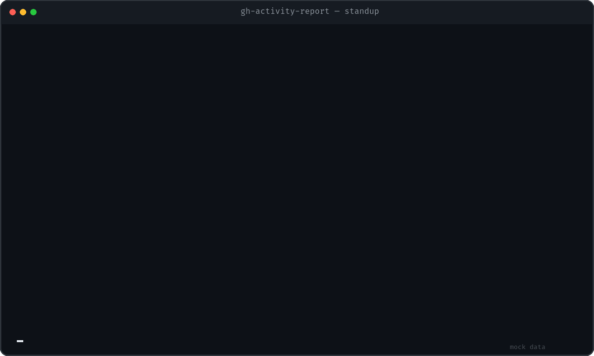

<!-- Allow this file to not have a first line heading -->
<!-- markdownlint-disable-file MD041 no-emphasis-as-heading -->

<!-- inline html -->
<!-- markdownlint-disable-file MD033 -->

<div align="center">

# `gh-activity-report`

**Turn recent GitHub activity into a pull-request-focused standup report.**

[](LICENSE)
[](https://deps.rs/repo/github/bwestlin/gh-activity-report)
[](https://www.rust-lang.org/)



<sub>Mocked example output. No real repository or activity data is shown.</sub>

</div>

`gh-activity-report` answers the question behind a daily standup: **which pull
requests and issues did I move forward?** It finds the owner of `GITHUB_TOKEN`,
collects their recent activity, connects commits and issues to pull requests,
groups unmatched pushes by branch, and ranks the resulting workstreams by
activity.

## Installation

Install directly from GitHub:

```sh
cargo install --git https://github.com/bwestlin/gh-activity-report
```

Or install the current source checkout:

```sh
cargo install --path .
```

Set a GitHub token before running the command:

```sh
export GITHUB_TOKEN=github_pat_...
```

The token owner is always the report subject. For private activity, the token
must be allowed to read the relevant repositories, pull requests, issues,
contents, and user events.

## Quick start

```sh
# Report yesterday's work (the default).
gh-activity-report

# Report the previous Monday through Sunday.
gh-activity-report last-week

# Report the current week through today.
gh-activity-report this-week

# Use an inclusive custom date range.
gh-activity-report --since 2026-10-01 --until 2026-10-15
```

Interactive output is colorized automatically. Pipes and redirects receive
plain text without ANSI escape sequences:

```sh
gh-activity-report last-week
gh-activity-report last-week | less
gh-activity-report last-week > standup.txt
```

## What the report shows

The report is organized around work moving through pull requests rather than a
list of repositories.

| Section | What it captures |
| --- | --- |
| Pull requests | Status, ownership, source and target branches, and overall activity |
| Commits | Pushes to known PR branches and merge or squash commits referencing a PR |
| Reviews | Approvals, comments, and change requests submitted by the token owner |
| Comments | Issue and review comments, with direct links and short excerpts |
| Related issues | GitHub closing relationships such as `Fixes #123`, plus other references |
| Branches without PRs | Commits grouped by repository and branch when no pull request exists |
| Standalone work | Issues and other activity that cannot be associated with a pull request |

Pull requests with the most activity are shown first. Inside each pull request,
the report presents commits, reviews, comments, PR progress, related issue
progress, and other events in that order. Pushed branches without pull requests
follow as their own ranked workstreams, before standalone issues and other
activity.

## Example output

The animated example above is generated from mock data. The equivalent plain
text output starts like this:

```text
GitHub progress for @octocat
Yesterday (2026-10-26) · 3 pull requests · 1 branch without PR · 2 issues · 16 activity signals

PULL REQUESTS MOVED FORWARD
1. acme/web#184 Cache authenticated API responses — Merged
   2 commits, 1 review, 2 comments, 2 PR updates
2. acme/api#77 Add request correlation IDs — Open
   1 commit, 1 review, 1 comment
3. acme/design#42 Refresh settings navigation — Draft

BRANCHES WITHOUT PULL REQUESTS

acme/web:feature/accessibility — 2 commits
  - 83c91ad Improve keyboard focus styles (16:12)
  - f0a27bc Add navigation landmark tests (15:48)
```

All names, numbers, titles, and dates in this example are fictional.

## Timeframes

| Value | Dates included |
| --- | --- |
| `yesterday` | The previous local calendar day; this is the default |
| `today` | Today through the current time |
| `this-week` | Monday through today |
| `last-week` | The previous Monday through Sunday |
| `last-7-days` | The seven complete calendar days before today |
| `--since DATE --until DATE` | An inclusive custom date range in `YYYY-MM-DD` format |

Calendar boundaries and displayed times use the machine's local timezone.

## Output formats

| Format | Behavior |
| --- | --- |
| `console` | Terminal layout with ANSI styling when supported |
| `text` | Plain text that never contains ANSI sequences |
| `markdown` | Linked Markdown suitable for notes or a standup document |
| `json` | Structured machine-readable output |
| `html` | Standalone responsive HTML with light, dark, and print styles |

Without `--format`, the command selects `console` for an interactive terminal
and `text` for a pipe or redirect. Select a format explicitly when needed:

```sh
gh-activity-report last-week --format markdown
gh-activity-report last-week --format json
gh-activity-report last-week --format html > report.html
gh-activity-report last-week --format text
```

Set `NO_COLOR=1` or `TERM=dumb` to disable console colors.

## How it works

1. The CLI identifies the authenticated user from `GITHUB_TOKEN`.
2. GitHub's Events API supplies recent pushes, reviews, comments, PR actions,
   issue actions, and other activity.
3. Pull request, commit, and issue data enrich the abbreviated event payloads.
4. GitHub's closing-issue relationship connects PRs to issues they may close.
5. Feature-branch pushes and merge or squash commits are associated with their
   pull requests when possible.
6. Remaining pushes are grouped by repository and branch instead of being
   folded into miscellaneous activity.

The tool uses read-only GitHub API calls.

## Limitations

GitHub's Events API is intended for recent activity and may be delayed. The
report warns when it reaches the available pagination limit. Use this tool as a
standup memory aid rather than as a complete audit log or time tracker.

Activity that GitHub does not associate with a pull request remains visible in
the branch or standalone sections instead of being guessed into a pull-request
workstream.

## Development

Run the local checks with:

```sh
cargo fmt --check
cargo test
cargo clippy --all-targets --all-features -- -D warnings
```

Regenerate the mocked terminal demo after changing console output:

```sh
scripts/render-demo.sh
```

The script requires ImageMagick and does not call GitHub or use
`GITHUB_TOKEN`.

## License

`gh-activity-report` is available under the [MIT License](LICENSE).
